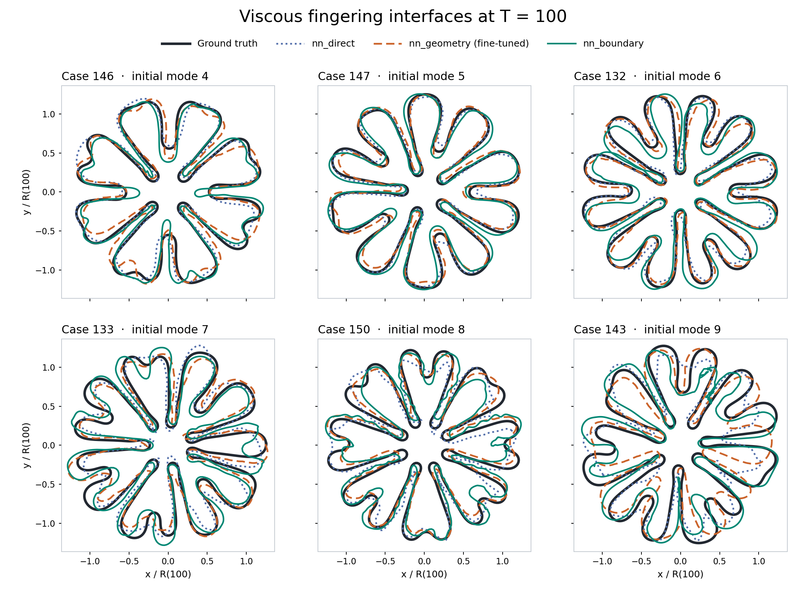

# 黏性指进界面预测

给定初始闭合界面，预测空气在二维径向 Hele–Shaw 薄隙中注入油后，各时刻的指进形态。中心恒流注入量为 $Q=2\pi$，表面张力为 $\sigma=0.015$，初始面积为 $\pi$。边界积分与时间推进离线生成监督标签，网络在等效半径 $R(t)=\sqrt{1+2t}$ 归一化的坐标中推理。



图中六例选自 24 个独立初形，覆盖六种初始主导模态。黑线为数值解，三条彩线分别为直接预测、微调几何模型和等变模型。六幅图共用坐标尺度。[选例方法与全样本结果](docs/experiments.md#六种初形的终点界面对比)

## 模型

| 模型 | 输入与更新 | 用途 |
|---|---|---|
| `nn_boundary` | 将初形、当前几何和近期法向运动编码为标量，经实偶 Fourier 核计算，沿外法向、径向和切向合成下一帧位移。 | **新架构主线**。单次前向对旋转、镜像和周期重编号等变。 |
| `nn_geometry` | 逐帧反馈。Fourier 主干与几何分支联合读取曲率、尖端凸度、法向运动及空间邻近弧段。 | **精度基准**。目录中的 `finetuned.pt` 用于上图，`model.pt` 为成熟的长滚动课程权重。 |
| `nn_direct` | 以初形和目标时间为输入，一次预测该时刻的坐标。 | 直接预测基准，提供 $T=100$ 和 $T=1000$ 权重。 |
| `nn_block` | 从初形、当前界面和运动历史联合预测四帧，在块末反馈。 | 比较四帧更新与逐帧更新。 |

在最近 8 个独立初形上，同预算从头训练 2400 步，`nn_boundary` 的 $T=100$ 平均终点轮廓误差为 **21.76%R**，`nn_geometry` 为 **24.46%R**（各两个种子）。充分训练的几何模型为 **19.97%R**。当前等变权重取种子 541、第 1600 步，按验证集完整轨迹的终点轮廓误差选出。[架构消融与自交记录](docs/experiments.md#等变边界算子与全边界积分)

## 数据与运行

依赖见 [requirements.txt](requirements.txt)。[T=100 数据](data/supervised/trajectories_t100_dense_128/summary.json) 和 [T=1000 数据](data/supervised/trajectories_t1000_128/summary.json) 共用 128 个初形，分别保存 177、265 帧，按初形划分为训练 112、验证 8、测试 8。训练时对整段轨迹同步旋转、反射并循环重编号。三个独立测试库覆盖 128–151 号初形。[长时轨迹叠图](data/img)

```sh
python -m src.nn_boundary.train
python -m src.predict nn_boundary --case 7
python -m utils.render --case results/supervised/models/nn_boundary
python -m utils.compare_interfaces
```

正式权重位于 `results/supervised/models/<模型>/model.pt`。新训练写入 `results/supervised/runs/<模型>/`，可用 `src.predict --model` 指定该次权重。推理导出的 `prediction.npz` 包含物理坐标下的预测、数值标签和时刻。其余模型使用各自的训练入口。

```sh
python -m src.nn_direct.train
python -m src.nn_block.train --warm results/supervised/models/rollout_warm.pt
python -m src.nn_geometry.train --warm results/supervised/models/rollout_warm.pt --long-rollout --initial-starts
python -m src.predict nn_direct --data data/supervised/trajectories_t1000_128 --model results/supervised/models/nn_direct/t1000/model.pt
```

数值求解与标签生成在 `src/traditional`，监督数据在 `data/supervised`，绘图工具在 `utils`。历次架构、训练、损失与稳定性实验按项记录在 [experiments.md](docs/experiments.md)。
